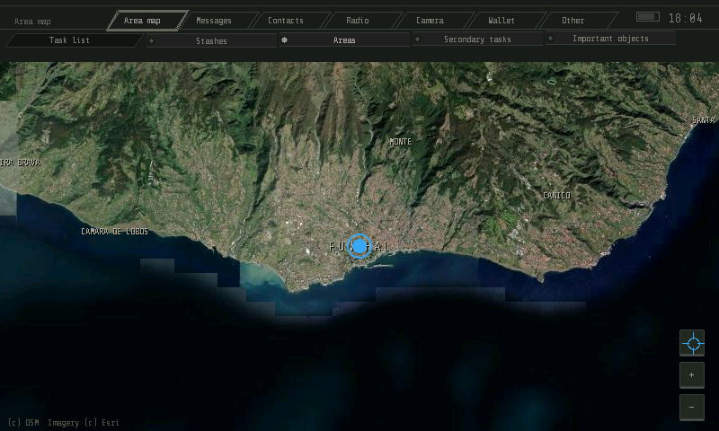
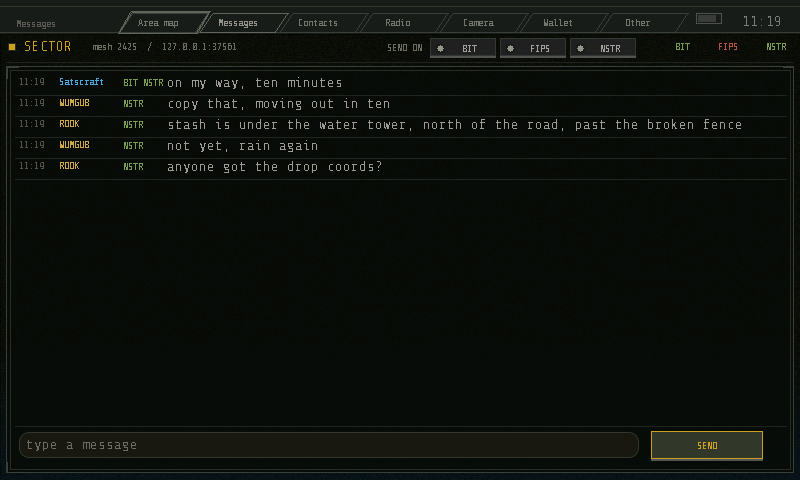
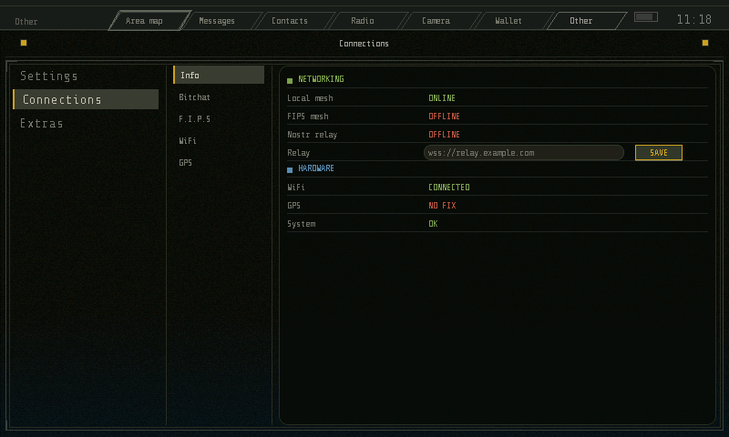
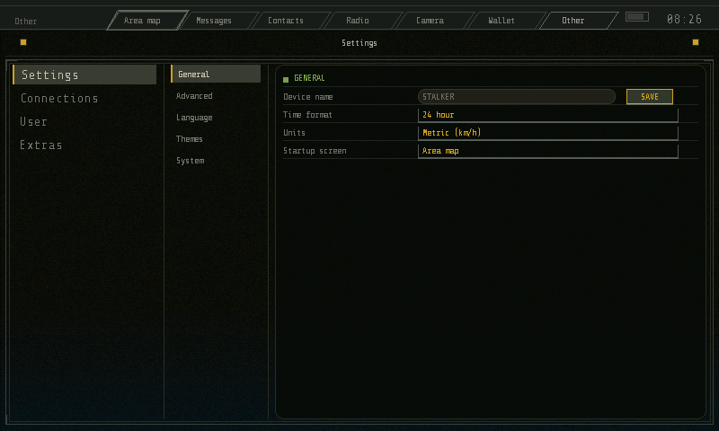
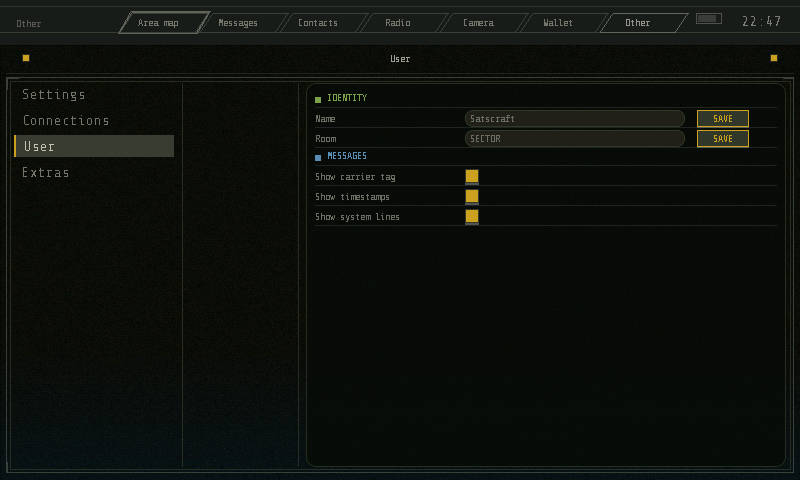
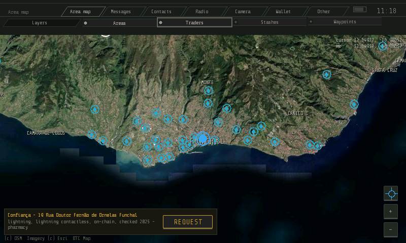
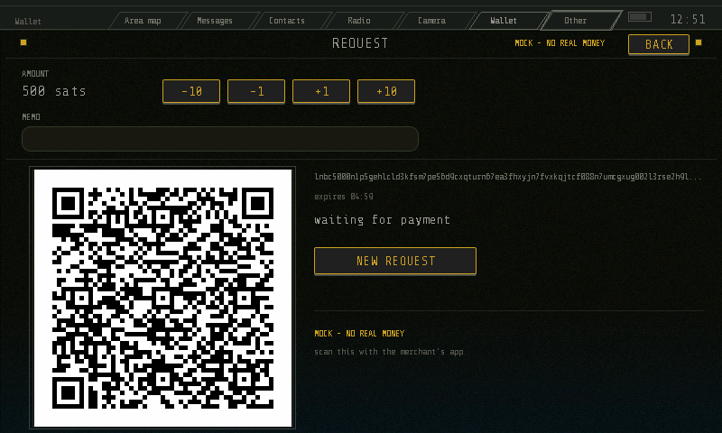

# S.T.A.L.K.E.R PDA Simulator

**v0.9.2-alpha**

A handheld communicator in the spirit of the STALKER PDA: an offline map, a group chat that works over the local mesh, the FIPS mesh and the internet, contacts and a Lightning wallet.

The UI is **LVGL v9** (C) in an 800x480 window. This repository is the **desktop simulator** of a device meant to run on a Raspberry Pi 3B with a 5" 800x480 HDMI screen and physical buttons.

## Screenshots

| Map | Messages |
|-----|----------|
|  |  |

| Connections | Settings | User |
|-------------|----------|------|
|  |  |  |

| Merchant card | Wallet request |
|---------------|----------------|
|  |  |

## Features

- **Offline map** with real Esri satellite imagery of Madeira, zoom 64–10923 (whole archipelago → ~1 m/px)
- **26 named places** (Funchal, Curral das Freiras, Pico Ruivo, Paúl da Serra, Porto Santo, Desertas…) drawn in tiers as you zoom
- **Four map layers** (Areas, Traders, Stashes, Waypoints) toggled by the strip under the tab bar; blue dot = GPS position
- **Waypoints & route**: right-click to place/remove; line drawn from position → waypoint → next; auto-removes at 5 m; remembered across restarts; Waypoints layer toggles it; CLEAR button in zoom column
- **Mouse & player coordinates** in top-right corner
- **Traders layer = real bitcoin merchants** from [BTC Map](https://btcmap.org) (OSM `currency:XBT=yes`) — 166 places on Madeira; bag-of-coins icon; tapping opens a card (name, address, lightning/contactless/on-chain/ATM, last checked year) with a **[REQUEST]** button that opens the Wallet for that merchant
- **Pack-based map system** — regions are self-contained folders, no code change to add new areas
- **Messages tab: one room, three carriers** (BIT local mesh, FIPS mesh, NSTR
  nostr relay); messages go out on all active carriers; incoming tagged by carrier
- **The internet carrier is a nostr relay** (`NSTR`): one WebSocket connection,
  TLS on `wss://`, stepped from the UI tick so a slow handshake never stalls it.
  The relay URL is one setting — `PDA_NSTR_RELAY=<url>` or Other → Connections →
  Info → **Relay** (env wins, the empty field shows an example) — and the room
  is scoped on the wire by the standard `t` tag plus a client-side backstop, so
  a public relay never fills the log with strangers' notes
- **Carrier picker** in Messages strip — per-carrier send toggle (off still receives); remembered in settings
- **Newest message at top** of log; scroll back for older lines
- **Signed messages (nostr NIP-01)**: every chat message is a real signed event —
  the device holds a keypair (`identity.nsec`, generated on first run, 0600, never
  in the repo or a log), the display name rides as a *signed* tag, and a peer
  cannot become somebody else by changing its name. The receive side recomputes
  the event id and verifies the BIP-340 signature before anything is trusted.
- **Trust & the verified badge**: the Contacts tab has two sections — SEEN
  (signed speakers heard this session) and TRUSTED (keys you pressed TRUST on,
  kept in `contacts.conf`). A message row shows the green verified mark only
  when the signature checked out **and** the key is one you Trusted; tap a row
  for its full `npub` to compare against the other device's User page.
- **`nstr` key row (Settings → User)**: the row is the editor now — the current
  `npub` is its greyed placeholder, a typed nsec + `[PASTE]` (or Enter) imports
  it (bech32 or 64-hex, validated before anything is saved), `[KEY]` reveals the
  full npub + nsec, `[NEW]` (two-press) regenerates. The long input scrolls
  sideways instead of wrapping.
- **Remote signer (nostr NIP-46)**: the nsec never has to live on the device.
  `[PAIR]` takes a `bunker://` token from Amber / nsec.app, `[CODE]` shows a
  `nostrconnect://` QR the phone scans, and while paired the signer's user key
  *is* the device identity \u2014 chat, Trust and the verified badge behave exactly
  as above, every signature is a relay round trip, and the local
  `identity.nsec` sits untouched until `[UNPAIR]`. A signer that does not
  answer withholds the message (kept locally, never sent unsigned). From
  `spec-nip46-signer.md`.
- **Mesh map** on Other → Connections → Bitchat — this device in center, peers around with names & lines; 5-min peer timeout
- **Local mesh uses broadcast + direct peer unicast** — subnet sweep finds peers, messages sent directly to known peers (bypasses firewall/AP broadcast drops); discovery row shows subnet
- **Firewall**: needs UDP 2425 (`sudo ufw allow 2425/udp`); Bitchat page warns when no peers answer
- **Other tab = control panel** — left column: Settings / Connections / Extras; sub-tabs across top; page below (the User page is one of Settings' sub-tabs)
- **Connections → Info** shows carrier status (green/grey/red); other pages show each system's settings
- **Settings → User** holds device name, room, message log switches (all editable, remembered)
- **Settings pages all work**: General, Advanced, Language (EN/PL), Themes (3 schemes × 3 accents), System
- **Recenter button** on map (zoom column) — jumps view to blue dot
- **STALKER guide aesthetic**: gritty surface, double-frame panels, crop-mark corners, hairline rules, coloured headings
- **STALKER-style UI**: parallelogram tab bar, layer toggle strip, battery gauge, live clock, gritty palette
- **GPS position** from gpsd NMEA socket (Pi); `PDA_GPS_LAT`/`PDA_GPS_LON` force position; `PDA_GPS_DEMO=1` for drift
- **Wheel zooms to cursor** (world point under pointer stays fixed); +/- buttons zoom around view center
- **Radio tab**: simple MP3 player styled like the STALKER music player -
  shuffle/loop toggles, track time, playlist and "Playing:" line in a central
  panel, rounded control plates below in three groups (playlist, repeat,
  shuffle / vol-, vol+ / prev, stop, play, next) with grey canvas-drawn
  icons, like the reference image. Scans a directory for MP3 files and plays
  them via `gst-launch-1.0`. The directory is configurable (`PDA_RADIO_DIR`,
  saved in settings). Auto-advances to the next track when one finishes.
- **Wallet tab, two backends behind one seam**: no backend is a *not set up*
  screen, an unknown one is named on an error screen, and the preview backend
  (`PDA_WALLET_BACKEND=mock`) wears a `MOCK - NO REAL MONEY` banner everywhere a
  balance shows. The real backend is **NIP-47 NWC**
  (`PDA_WALLET_BACKEND=nwc`): paste a `nostr+walletconnect://` connection from
  your own wallet app once on the not-set-up screen, and the same screens talk
  to the real service over the relay — real BOLT11 invoices, real balance,
  payments that move the money, a fee line that says the fee is unknown until
  the payment says otherwise. Both plug into the same `wallet.h` seam without
  any screen assuming a backend (LDK / Cashu remain LATER candidates).
- **REQUEST → QR → PAID**: amount keypad + memo, the invoice as a QR code
  (BOLT11, ECC level L, up to version 17), expiry countdown, and the settle
  that flips the screen to PAID and moves the balance. SEND takes an invoice
  from a paste or from `PDA_INVOICE` and shows amount and fee before [PAY] will
  move anything; HISTORY is the rows the backend kept, in the state file, and
  it comes back after a restart. `[SCAN]` stays dimmed with its reason — there
  is no camera in this build, and nothing pretends to work.
- **Merchant card [REQUEST]**: tapping a trader on the map opens its card, and
  the button on it goes straight to a request with the merchant's name as the
  memo — the PDA is the invoice side, the merchant's terminal scans what it
  shows. A merchant that needs its own app gets no button (it will not take a
  plain BOLT11).

## Carriers

| Carrier | Transport | Requirements |
|---------|-----------|--------------|
| **BIT** | UDP broadcast port 2425 (bitchat channel `#mesh`) | LAN/WiFi; WiFi = radio. No Bluetooth in simulator; real bitchat node via `PDA_BITCHAT_SOCK` bridge |
| **NSTR** | Nostr relay: WebSocket + TLS (`src/nstr/`) | A relay URL — `PDA_NSTR_RELAY=wss://relay.example.com` or the Connections → Info row; any NIP-01 relay works (`tools/nstr_relay.py` is the local test one) |
| **FIPS** | `fips` daemon native API (`/run/fips/api.sock`) | Daemon running; without it badge = red `no daemon` |

When no carrier can send: `no carrier up - kept locally (BIT no link, FIPS no daemon, NSTR no relay)`.

All three carriers carry the same wire format: one **signed nostr NIP-01 event**
(`id` = SHA-256 of the canonical serialization, `sig` = BIP-340; the display
name, the `room` and the same value as `t` (the single-letter key relays index)
are signed tags). The LAN carriers carry it as one JSON object per line, the
relay carrier as one WebSocket text message. Discovery chatter (`hi`,
`hi-ack`) stays unsigned legacy `{"v":1,"t":...}` on the LAN carriers — it
carries no speech and grants no trust. Unsigned events (tests) keep the same
shape with `pubkey:""` and no `sig` field.

## Build

```bash
sudo apt install cmake libsdl2-dev libsdl2-image-dev libpng-dev zlib1g-dev nodejs npm libglib2.0-dev libssl-dev
./tools/fetch_deps.sh     # fetches LVGL v9.6.0 + reassembles split map levels
./build.sh                # -> build/pda
./build/pda               # 800x480 SDL window
# the test suites drive the real window and need:
sudo apt install gnome-screenshot wmctrl python3-pil python3-xlib libzbar0t64
python3 -m pip install --user pyzbar   # the Wallet test decodes the QR on screen
```

## Map Packs

```
assets/maps/<name>/
    pack.cfg        bbox + "level <z> <w> <h> <ox> <oy>" per level
    z<z>.rgb565     imagery, raw RGB565, row-major
```

App scans `assets/maps/*/pack.cfg` at startup. Override with `PDA_MAPS=/path/to/maps`.

Included packs:

| Pack | Levels | Coverage |
|------|--------|----------|
| `madeira` | z12, z13 | whole archipelago + Porto Santo + Desertas |
| `madeira-island` | z14 | island, ~9.5 m/px |
| `funchal` | z15, z16, z17 | Funchal area, down to ~1.2 m/px |

Large levels >100 MB stored as split parts (`z14.rgb565.part*`, `z17.rgb565.part*`); `tools/fetch_deps.sh` reassembles.

## Traders Pack (BTC Map)

```
assets/poi/<name>/
    pack.cfg        manifest: name, count, source, date, licence
    places.bin      152-byte fixed records
```

```bash
python3 tools/fetch_btc.py --name madeira --lat 32.6669 --lon -16.9247 --radius-km 30
# or: python3 tools/fetch_btc.py --name madeira --bbox 32.55,-17.45,33.25,-16.55
```

Madeira: 166 places, 25 KB. Whole planet: ~30k places, 4.5 MB.

## Tools

| Tool | Purpose |
|------|---------|
| `tools/fetch_map.py` | build map pack from Esri tiles |
| `tools/fetch_btc.py` | build traders pack from BTC Map |
| `tools/rgb565_pack.c` | fast RGB565 packer |
| `tools/analyze_map.py` | screenshot analysis: zoom steps, scale, geo-alignment, pan, artifacts |
| `tools/chat_test.py` | end-to-end test: relay, mesh, sweep, FIPS |
| `tools/mesh_netns_test.sh` | mesh over real link (veth + netns); needs root |
| `tools/ui_test.py` | UI bug hunt: every tab/page, settings, broken prefs, mesh channel, recenter, hard drive |
| `tools/radio_kill_test.py` | the music player must die with the app: window close, close while paused, SIGINT, SIGKILL, retheme |
| `tools/relay.py` | the old line relay (a standalone tool; nothing points at it any more) |
| `tools/nstr_relay.py` | the local relay the suites point the app at: WebSocket + NIP-01, `--tls`, control plane on stdin |
| `tools/wsclient.py` | stdlib WebSocket client the test peers, the screenshots and the live check speak |
| `tools/bitchat_bridge.py` | bridge local mesh ↔ real bitchat node |
| `tools/fips_mock.py` | mock fips daemon for testing |
| `tools/make_screenshots.py` | regenerate docs/screenshots/ |
| `tools/gen_fonts.sh` | regenerate bitmap fonts (Share Tech Mono, VT323, DSEG7) |
| `tools/fix_fallback.py` | wire a fallback font into a generated font (Polish coverage) |
| `tools/fetch_deps.sh` | fetch LVGL + reassemble split map levels |

## Status

Map screen, Messages tab (3 carriers), Radio tab (MP3 player), Wallet tab (request/QR, send, history — with two backends: the mock that says it is one, and **NIP-47 NWC** against your own wallet service, from `spec-nip47-wallet.md`), Other tab (all settings work) functional. Camera is the last visible stub tab (Contacts is built: trusted keys + session speakers, from `spec-nostr-identity.md`). TODO: camera, real nav stack, GPIO/evdev input, Pi port (DRM/KMS + systemd boot-to-app); a second wallet backend (LDK / NIP-60 Cashu) stays LATER behind the same seam. Extras page empty; partially translated — 98 keys EN + PL in the `TR_` table, while the Camera stub panel, the map's flag words, the wallet backend's own messages and the chat/identity SYSTEM log lines are still English.

## License

Do whatever you want with it.